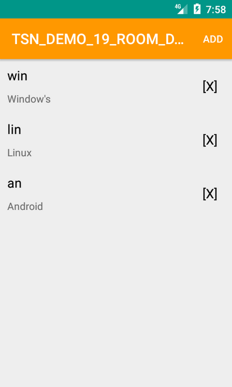
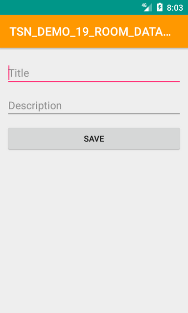
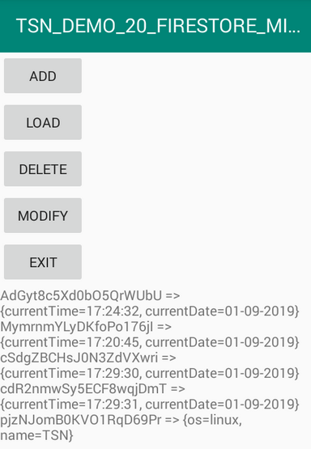
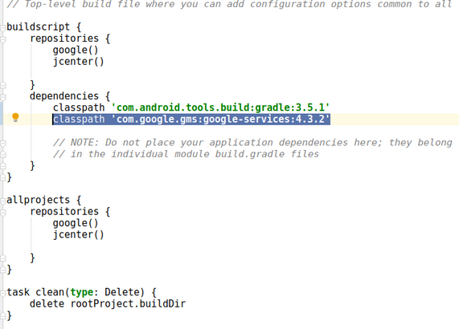

# TSN_ANDROID_08-Databases

**Работа с ROOM-базой данных (+ технология ButterKnife)**

---

**Простейший пример работы с облачной базой данных FIREBASE FIRESTORE (NoSQL Cloud Firestore)**

*На бесплатном тарифе в день можно прочитать 50000 записей, записать 20000 и 20000 удалить.*

Если не будет прописана выделенная зависимость, то проект не запустится:

